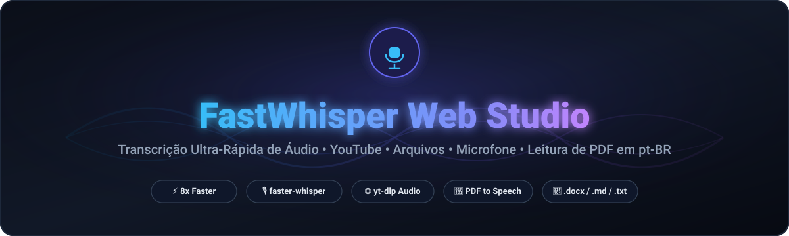
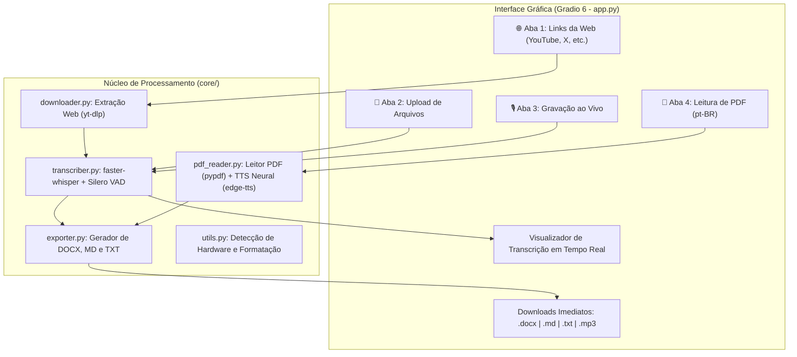

<div align="center">

  <!-- Banner Principal -->
  

  <br/><br/>

  <!-- Badges de Status e Versão -->
  <p align="center">
    <a href="https://github.com/EmmanuelNunes/fastwhisper-web-studio">
      
    </a>
    <a href="https://www.python.org/downloads/">
      
    </a>
    <a href="https://github.com/openai/whisper">
      
    </a>
    <a href="https://gradio.app/">
      
    </a>
    <a href="LICENSE">
      
    </a>
  </p>

  <!-- Badges de Métricas do Repositório -->
  <p align="center">
    
    
    
  </p>

  <p align="center">
    <b>Uma estação de trabalho local, visual e ultrarrápida para transformar áudio e documentos em inteligência textual formatada.</b><br/>
    Transcreva vídeos da Web (YouTube, podcasts), arquivos locais e microfone para <b>.docx</b>, <b>.md</b> e <b>.txt</b> — além de narrar PDFs em português com IA neural!
  </p>

  <p align="center">
    <a href="#-principais-recursos">Recursos</a> •
    <a href="#-comparativo-de-performance">Comparativo</a> •
    <a href="#-tecnologias-utilizadas">Tecnologias</a> •
    <a href="#-como-iniciar-em-1-clique-windows">Como Usar</a> •
    <a href="#-arquitetura-do-sistema">Arquitetura</a> •
    <a href="#-sobre-o-autor">Autor</a>
  </p>

</div>

---

## 📌 Visão Geral

O **FastWhisper Web Studio** nasceu para solucionar os dois maiores gargalos de ferramentas de IA para áudio: a **lentidão** do repositório padrão `openai/whisper` e a **dificuldade de exportação** em formatos prontos para uso corporativo e acadêmico.

Utilizando a reimplementação C++ em **CTranslate2 (`faster-whisper`)** e o algoritmo **Silero VAD**, o aplicativo transcreve áudios com velocidade até **8x superior ao tempo real**, com suporte a quantização `int8` (para alto desempenho em qualquer CPU) e `float16` (para aceleração em placas NVIDIA CUDA).

---

## ⚡ Comparativo de Performance

| Funcionalidade / Métrica | OpenAI Whisper Padrão | FastWhisper Web Studio |
| :--- | :---: | :---: |
| **Motor de Inferência** | PyTorch puro (Python) | **CTranslate2 (C++ Otimizado)** |
| **Velocidade de Processamento** | 1x (Base de referência) | **4x a 8x mais rápido** ⚡ |
| **Consumo de Memória (VRAM / RAM)** | Alto (estouro frequente) | **Redução de até 70%** (quantização int8/float16) |
| **Filtro de Silêncio / Ruído** | Inexistente (alucina em silêncios) | **Silero VAD Integrado** (pula pausas) |
| **Extração Direta de Vídeos/Sites** | ❌ Não suporta | **✅ Suporta YouTube, X, Podcasts via yt-dlp** |
| **Entrada ao Vivo** | ❌ Não suporta | **✅ Gravação de microfone no navegador** |
| **Leitura de PDF em pt-BR** | ❌ Não suporta | **✅ Vozes Neurais Humanas (Edge-TTS)** |
| **Exportação Automática** | .txt bruto | **📄 .docx (Word estilizado) + 📝 .md + 📃 .txt** |

---

## 🛠️ Tecnologias Utilizadas

<div align="center">

| Tecnologia | Descrição | Badge |
| :--- | :--- | :--- |
| **Python** | Linguagem principal do ecossistema |  |
| **faster-whisper** | Motor ultrarrápido com CTranslate2 |  |
| **Gradio 6** | Interface web moderna e responsiva |  |
| **yt-dlp** | Extração direta de áudio da Web |  |
| **Edge-TTS** | Síntese de voz neural humana em pt-BR |  |
| **python-docx** | Geração e estilização de documentos Word |  |
| **FFmpeg** | Decodificação e conversão de mídia |  |
| **Pytest** | Suíte com 18 testes automatizados |  |

</div>

---

## 🌟 Principais Recursos

### 🌐 1. Extração Direta de Sites e Redes Sociais
Cole o link de vídeos do **YouTube, Twitter/X, Instagram, SoundCloud, podcasts**, etc. O aplicativo baixa apenas a faixa de áudio em segundos com o `yt-dlp`, sem gastar gigabytes baixando o vídeo em alta definição.

### 📁 2. Upload e Suporte Universal de Arquivos
Arraste arquivos locais de áudio ou vídeo (`.mp3`, `.wav`, `.m4a`, `.mp4`, `.mkv`, `.ogg`, `.flac`, `.aac`, `.webm`, etc.). A ferramenta analisa o formato e processa em fluxo contínuo.

### 🎙️ 3. Gravação de Áudio ao Vivo
Grave áudio pelo microfone diretamente na interface web. Ideal para ditar reuniões, memorandos, palestras e pensamentos instantâneos.

### 📑 4. Leitura e Narração de PDF em pt-BR com Vozes de IA
* Extração do texto de documentos `.pdf` página por página preservando títulos e parágrafos.
* Narração em áudio falado natural utilizando as vozes neurais brasileiras mais avançadas:
  * 👩 **Francisca Neural** — Fluida, clara e natural (padrão).
  * 👨 **Antonio Neural** — Firme, corporativo e profissional.
  * 👩 **Thalita Neural** — Expressiva e conversacional.
* Controle de velocidade da fala (`+0%`, `+20%`, `+40%`, `-15%`).
* Player com download do áudio `.mp3` e exportação do texto em Word, Markdown e TXT.

### 📥 5. Exportação Imediata Multi-Formato
Com 1 clique, você baixa o resultado nos 3 formatos:
* **📄 Word (`.docx`):** Documento formatado com capa, tabela de metadados (duração, data, idioma com probabilidade, modelo), marcas de tempo opcionais `[00:01:23]` e parágrafos estruturados.
* **📝 Markdown (`.md`):** Estrutura limpa com metadados em frontmatter YAML para Obsidian, Notion ou documentações.
* **📃 Texto Puro (`.txt`):** Texto corrido limpo, pronto para leitura ou ingestão em LLMs.

---

## 🚀 Como Iniciar em 1 Clique (Windows)

Não é necessário configurar variáveis de ambiente nem instalar dependências manualmente. Basta dar dois cliques no arquivo:

```cmd
iniciar.bat
```

O launcher executará automaticamente:
1. Criação do ambiente virtual isolado (`.venv`).
2. Instalação e atualização dos pacotes necessários.
3. Inicialização do servidor local e abertura automática no seu navegador em **`http://127.0.0.1:7860`**.

---

## 🛠️ Inicialização Manual via Terminal

```bash
# 1. Clone o repositório
git clone https://github.com/EmmanuelNunes/fastwhisper-web-studio.git
cd fastwhisper-web-studio

# 2. Crie e ative o ambiente virtual
python -m venv .venv
.\.venv\Scripts\activate   # No Linux/macOS: source .venv/bin/activate

# 3. Instale as dependências
pip install -r requirements.txt

# 4. Inicie o aplicativo
python app.py
```
Acesse no seu navegador: **`http://127.0.0.1:7860`**

---

## 🏛️ Arquitetura do Sistema



---

## 🧪 Suíte de Testes Automatizados

O projeto conta com **18 testes automatizados** cobrindo todos os módulos do sistema:

```bash
.\.venv\Scripts\python -m pytest tests/
```

Saída da verificação:
```
============================= test session starts =============================
collected 18 items

tests\test_downloader.py ...                                             [ 16%]
tests\test_exporter.py ..                                                [ 27%]
tests\test_pdf_reader.py ....                                            [ 50%]
tests\test_transcriber.py ...                                            [ 66%]
tests\test_utils.py ......                                               [100%]

============================= 18 passed in 3.30s ==============================
```

---

## 📂 Estrutura do Repositório

```
fastwhisper-web-studio/
├── app.py                  # Interface Web Gradio completa
├── iniciar.bat             # Launcher automatizado de 1 clique para Windows
├── requirements.txt        # Dependências do projeto
├── README.md               # Documentação oficial
├── LICENSE                 # Licença MIT de código aberto
├── assets/                 # Recursos visuais (banners, logos)
│   └── banner.svg          # Banner estilizado do projeto
├── core/                   # Núcleo modular da aplicação
│   ├── __init__.py
│   ├── transcriber.py      # Motor de IA faster-whisper + Silero VAD
│   ├── downloader.py       # Extração de URLs via yt-dlp
│   ├── pdf_reader.py       # Extração de PDF e narração de voz pt-BR
│   ├── exporter.py         # Exportação em .docx, .md e .txt
│   └── utils.py            # Utilitários de tempo e detecção de hardware
├── tests/                  # Testes automatizados (pytest)
│   ├── test_transcriber.py
│   ├── test_downloader.py
│   ├── test_pdf_reader.py
│   ├── test_exporter.py
│   └── test_utils.py
├── outputs/                # Destino dos arquivos gerados (Word, Markdown, TXT)
└── temp_audio/             # Armazenamento temporário de áudios baixados
```

---

## 👤 Sobre o Autor

<div align="center">

### **Emmanuel Nunes**
*Desenvolvedor de Software & Entusiasta em Inteligência Artificial e Automação*

[](https://github.com/EmmanuelNunes)
[](https://github.com/EmmanuelNunes/fastwhisper-web-studio)

</div>

---

## 📄 Licença

Este projeto está licenciado sob a **Licença MIT** — consulte o arquivo [LICENSE](LICENSE) para obter mais detalhes.

---

<div align="center">
  <sub>Desenvolvido com 💙 por Emmanuel Nunes • 2026</sub>
</div>
